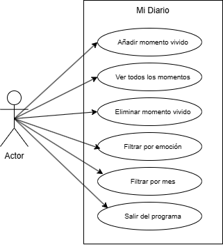
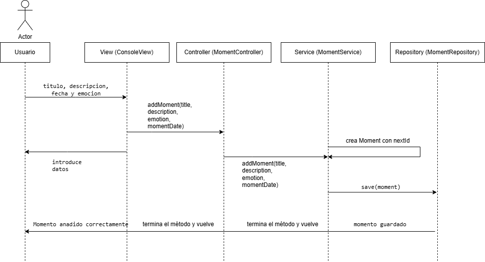
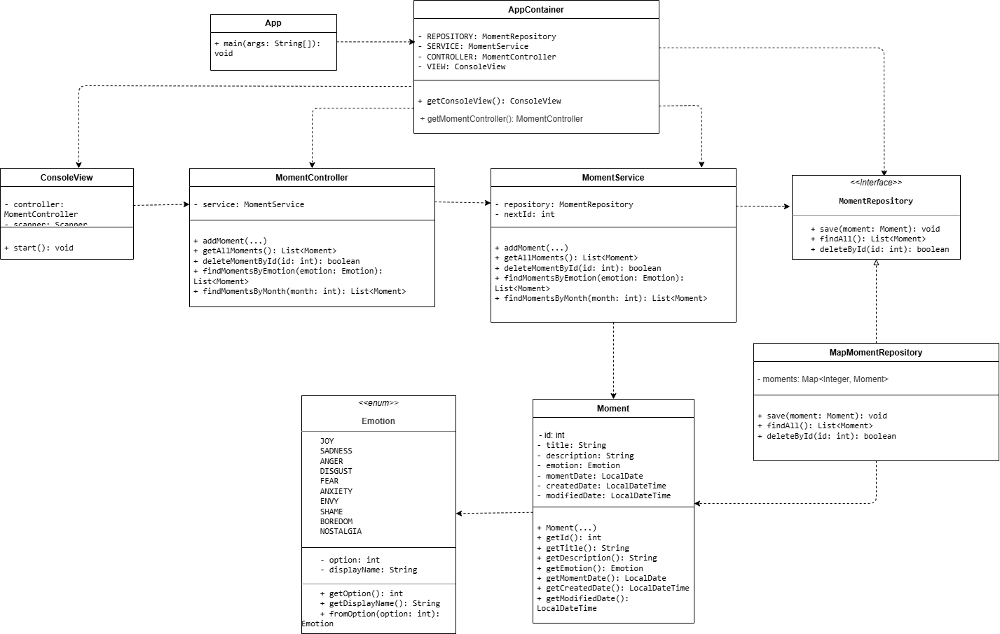

# Project Inside Out - Mi Diario

## Descripcion

Este proyecto es una aplicacion de consola hecha en Java para gestionar momentos vividos en un diario personal.

La aplicacion permite anadir recuerdos, asociarlos a una emocion, ver todos los momentos guardados, eliminarlos por identificador y filtrarlos por emocion o por mes.

El proyecto esta organizado separando responsabilidades:

- `model`: datos principales (`Moment`, `Emotion`).
- `repository`: persistencia en memoria usando `Map`.
- `service`: logica de las historias de usuario.
- `controller`: puente entre la vista y el servicio.
- `view`: menu de consola con `Scanner`.
- `config`: creacion de dependencias como eager singletons.

## Pre-requisitos

Para ejecutar el proyecto necesito tener instalado:

- Java 21
- Maven 3.6.3 o superior
- Git

## Pasos para la instalacion

Clonar el repositorio:

```bash
git clone <url-del-repositorio>
```

Entrar en la carpeta del proyecto:

```bash
cd project-java-consoleapp-inside-out
```

Compilar:

```bash
mvn compile
```

Ejecutar la aplicacion:

```bash
java -cp target/classes org.factoriaf5.project_inside_out.App
```

## Ejecucion de los tests

Para ejecutar los tests del proyecto:

```bash
mvn test
```

Estado actual:

- Hay tests unitarios para el modelo (`Moment` y `Emotion`).
- Hay tests para el repositorio en memoria (`MapMomentRepository`).
- Hay tests para el servicio (`MomentService`) con las historias de usuario principales.
- Hay tests para la vista de consola (`ConsoleView`) usando entrada y salida simulada con `System.in` y `System.out`.
- Los tests comprueban anadir, listar, eliminar y filtrar momentos por emocion y por mes.
- Tambien se comprueba la validacion del formato de fecha y la opcion de salir del programa.

## Diagramas

### Diagrama UML de casos de uso



### Diagrama UML de secuencia



### Diagrama UML de clases



## Autores

Proyecto realizado por Ekaterina Zotova como ejercicio de practica backend en Factoria F5.
